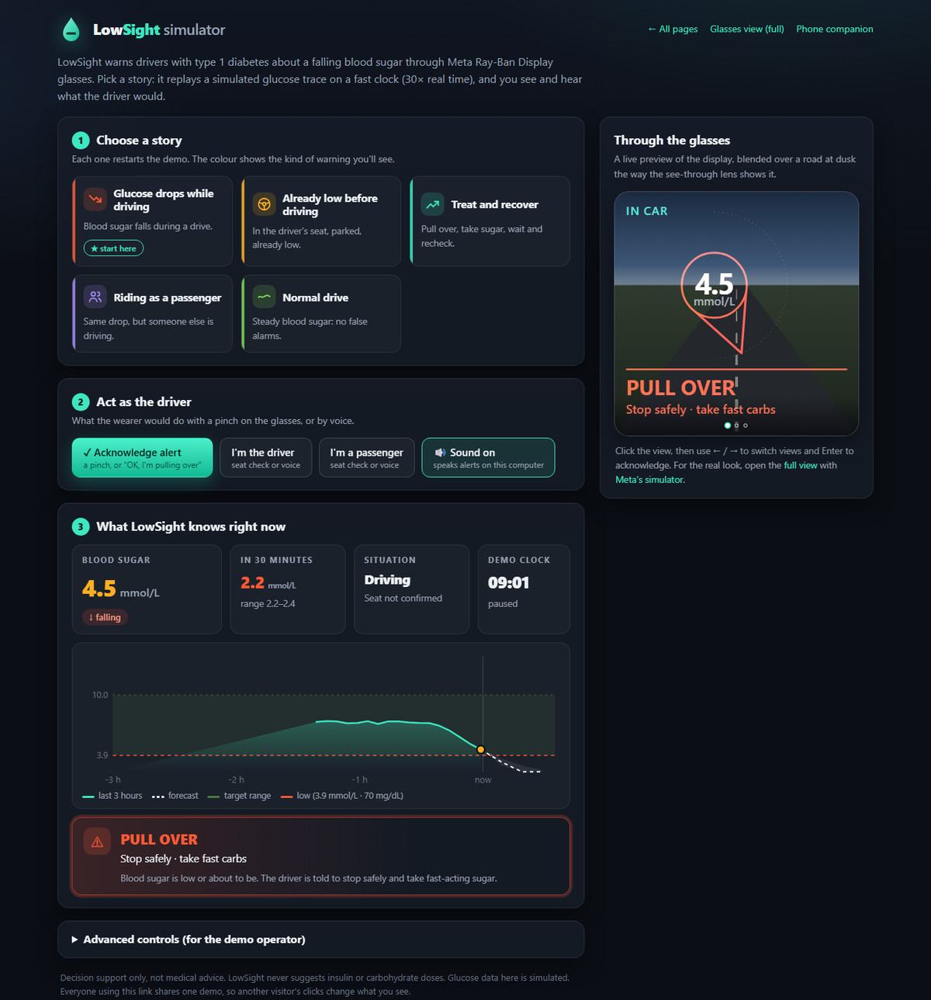
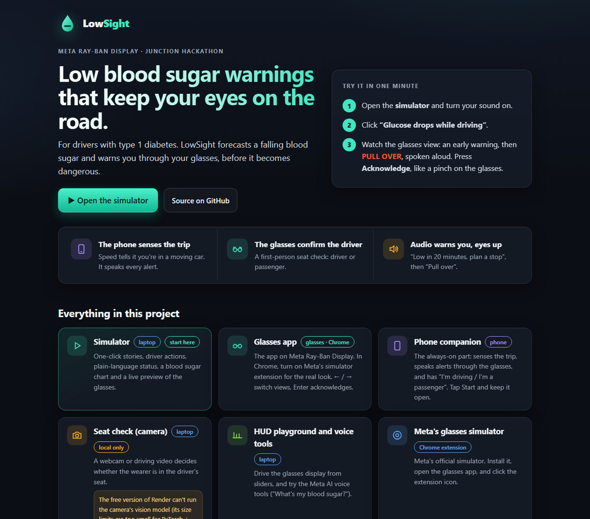
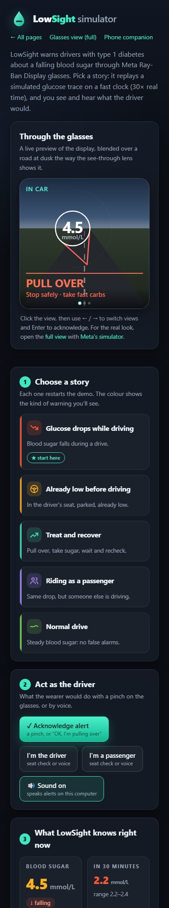

# LowSight

Eyes-up hypoglycaemia alerts for drivers with type 1 diabetes, built for Meta Ray-Ban Display
(Junction hackathon, Meta glasses challenge). **The phone senses the trip, the glasses confirm you're the
driver, and audio warns you with your eyes up.** LowSight watches the CGM trend and a short-horizon
forecast and gives escalating, audio-first alerts: **Low soon**, **Pull over**, and a **pre-drive check**.

Glasses sessions last at most 3 minutes and only the wearer can start them, so the phone does the
always-on work: it detects the trip and speaks alerts, which are heard through the glasses speakers (verified on
real glasses). Display notifications from a browser page didn't reach the glasses in testing; a native phone app is
the path for those. The glasses camera does a one-off seat check when the wearer opens LowSight.

> **Not medical advice.** LowSight is decision support. It never suggests insulin doses.

**▶ Live demo: [low-sight.onrender.com](https://low-sight.onrender.com/)**. New here? Watch the
[60-second guided demo](https://low-sight.onrender.com/tour/): it plays by itself, with sound. Then explore every
situation in the [simulator](https://low-sight.onrender.com/control/). The free
Render plan sleeps when idle, so the first load can take about a minute. It also can't run the camera's vision
model (size limits), so run the project locally for the real camera seat check.



<p>
  
  
</p>

Full spec: [LOWSIGHT_BUILD_PLAN.md](LOWSIGHT_BUILD_PLAN.md). Task list: [TODO.md](TODO.md).

## Status

| Milestone | State |
|---|---|
| M0: skeleton, config, models, DemoClock, health, static mounts | ✅ |
| M1: synthetic scenarios, ReplaySource, baseline forecaster, `/ws/state`, ambient HUD | ✅ (runs in Meta's simulator) |
| Phone companion: trip detection, driver/passenger context, speaks + notifies alerts | ✅ (`/phone`, `/api/phone`) |
| M2: alert engine (all 5 levels, dedupe, hysteresis, ack) + tests + control panel | ✅ |
| M3: seat check: camera page, `/ws/frames`, CLIP detector, `eval_vision.py` | Implemented; a reported run found 4/4 driver matches on a small public-photo prompt check. This is not a representative accuracy metric; labelled project footage is still needed. |
| M4: PRE_DRIVE (seat check and trip start), RECOVERING countdown, stage audio, PULL_OVER repeat | ✅ (audio uses `speechSynthesis`; no mp3s, see TODO) |
| M5: polish and numbers | partly: forecast floor, stale states, Meta metadata and fluid layout done; legibility, device checks and numbers need people and hardware |
| M6–M7 | not started |

The glasses HUD is the plain HTML/CSS/JS app in `web/hud/` (~36 KB, no build step). An experimental React
version built on Meta's UI Toolkit is archived in [archive/hud-app/](archive/hud-app/): its ~500 KB bundle is
over Meta's first-load budget (under 300 KB, fewer than 15 requests).

## Running it

```bash
uv sync --group dev                       # backend and test dependencies
uv sync --extra vision --group dev        # also install CLIP vision dependencies
uv run python scripts/make_scenarios.py  # writes data/scenarios/*.csv (already committed)
uv run uvicorn backend.app:app --port 8000
cloudflared tunnel --url http://localhost:8000   # → https://<random>.trycloudflare.com
```

`requirements.txt` remains available as a pip-compatible dependency list; `pyproject.toml` and
`uv.lock` are the supported uv setup. The vision extra installs large packages and downloads
model weights on first use. On Windows, install the tunnel with `winget install --id Cloudflare.cloudflared`.

1. Open `https://<tunnel>/control/` on the laptop. On the phone paired with the glasses, open
   `https://<tunnel>/phone/` and tap **Start** (keep it in front; it holds a wake lock). Open
   `https://<tunnel>/camera/` on the device you use as the "glasses camera" for the seat check.
2. Load the HUD in the **Meta Ray-Ban Display Simulator**, Meta's official Chrome extension
   ([Chrome Web Store](https://chromewebstore.google.com/detail/jpjlmmodokemlepklkdbimceggpbjcll)). Open
   `http://localhost:8000/hud/` (or the tunnel URL) in Chrome and click the extension icon to turn the simulator
   on. Its D-pad and **Select** send arrow and Enter key events to the page. Pick a bright and a driving
   background to check legibility. It can also record a WebM for the demo video and generate a
   "View on Glasses QR" (that one needs the tunnel URL).
3. On real glasses (from Meta's [Test](https://wearables.developer.meta.com/docs/develop/webapps/test/) page):
   enable Developer Mode in the Meta AI app (Settings → App Info → tap the app version 5 times), then
   **App Settings → Apps → Web Apps → Connect Web App**, enter the HTTPS HUD URL and **Save**. Needs glasses
   software v125+ and Meta AI app v272+.

Locally, without a tunnel: http://localhost:8000/hud/, /control/, /phone/ and /camera/. (GPS, the camera and
notifications on a real phone need HTTPS, so use the tunnel for those.)

### Start page and simulator
The site root (`/`) opens the **start page** (`/start/`): what LowSight is, a one-minute walkthrough, and links to
every page. Send judges there. The **simulator** (`/control/`) has one-click stories (glucose drops while driving,
low before driving, treat and recover, passenger, normal drive), each with "what to expect"; driver actions
(acknowledge, "I'm the driver / a passenger", sound); plain-language status; and a live, muted preview of the
glasses view (`/hud/?mute`; the simulator page speaks the alerts itself). The operator controls (scenario, clock,
jumps, in-car and seat overrides, units, event log) are under **Advanced controls**.

### Demo flow (plan §11)
- **Pre-drive:** the story "Already low before driving", or scenario `low_before_drive` and a seat check on
  `/camera/` (local only, see below). The HUD shows "Driver seat ✓" and **CHECK BEFORE DRIVING**.
- **Low soon → pull over:** the story "Glucose drops while driving": LOW_SOON at the 50-min reading, PULL_OVER at
  60. Acknowledge with Enter on the HUD or the simulator's button; "Treat and recover" then shows
  **WAIT · RECHECK** with a countdown once glucose rises.
- **Sound** on the simulator speaks alerts through the laptop, so the room hears them.
- **Camera seat check:** only when running locally. The free version of Render can't hold the vision model (size
  limits), so on the hosted site use the camera page's simulate buttons or "I'm the driver".

### HUD
The glucose view shows the value inside a ring. A **trend spike** orbits the ring like a CGM arrow:
pointing right is steady, up is rising, down is falling (fully up or down at ±3 mg/dL/min). It glides between
readings and blends green → orange when rising, green → red when falling. The ring takes the alert colour
(amber LOW_SOON / PRE_DRIVE, pulsing red PULL_OVER, cyan RECOVERING) and turns grey with the spike hidden when
the data is stale. The sparkline and forecast are on the Forecast view.

- `←` / `→`: cycle views (Glucose / Forecast detail / About)
- `Enter` (Neural Band select): acknowledge the current alert. It stops the PULL_OVER repeat and keeps the banner.

**Dev page:** <http://localhost:8000/hud/dev.html> embeds the HUD (`/hud/?dev`) and drives it from sliders
(value, trend, alert, acknowledged, trend sweep, fake readings every 2 s) without the backend. Use it in a
normal tab; use `/hud/` itself in the simulator.

### Voice (Meta AI, WebMCP)
The HUD registers three tools on `document.modelContext` ([web/hud/webmcp.js](web/hud/webmcp.js)), so the
wearer can talk to Meta AI instead of using the Neural Band:

| The wearer says | Tool | What happens |
|---|---|---|
| "What's my glucose?", "Am I going low?", "When do I recheck?" | `lowsight_get_status` | Read-only: value, trend, forecast, active alert, recheck time, driving context |
| "OK, I'm pulling over." | `lowsight_acknowledge_alert` | Same as Select; it reports success only after the backend confirms |
| "Show me the forecast." | `lowsight_show_view` | Switches the display to glucose, forecast or about |
| "I'm driving." / "I'm a passenger." | `lowsight_confirm_seat` | Sets the seat like a camera seat check (see below); Meta AI must pass exactly `driver` or `passenger` |

Every result tells Meta AI to answer in one or two short sentences, never to give insulin or carb doses and
never to say it is safe to drive. The same guardrails are in the page's `<meta name="description">`.
The tools are optional: if `document.modelContext` is missing or a registration fails, the HUD works as before.
Meta AI's page instructions (identity, what's on screen, the rules) are in [web/hud/llms.txt](web/hud/llms.txt),
served at `/hud/llms.txt` and `/llms.txt`. Tool results carry their own `next_action`; problems come back as
`{error, message, next_action}`, and the page confirms every acknowledgement or seat change before reporting success.
WebMCP is off by default on the glasses (Developer Mode or rollout) and is decided at launch, so relaunch the
app after turning it on. The dev page's **Voice** panel calls the same tools and shows exactly what Meta AI
gets back, so you can test and demo them without glasses.

### Audio
The phone speaks each alert once (alert `id`s are unique) and reports it back. The HUD, if open, only speaks
an alert that no phone reported within 2.5 s, using `speechSynthesis` (supported on Meta Ray-Ban Display web
apps: one en-US voice). An alert that was already spoken this episode updates silently.

### Seat check
`/camera/` sends a 384 px JPEG every 500 ms over `/ws/frames` for at most 3 minutes, and stops once the seat
is decided (EMA > 0.70 or < 0.30 held for 3 s). Without the vision dependencies the page says so; use
**Test without the vision model** (simulated scores through the same smoothing) or the control-panel seat
override. To get the accuracy number for the pitch, put labelled frames in `data/vision/{driver,passenger,other}/`
and run `python scripts/eval_vision.py`.

**Without a camera** (glasses web apps can't use the glasses camera): the wearer can say "I'm driving" / "I'm a
passenger" to Meta AI, or tap **I'm driving** / **I'm a passenger** on `/phone/`. Both send
`{"type": "seat", "role": …}` on `/ws/state` and work exactly like a decided seat check: the seat holds for the
trip, carries into a trip that starts within 5 minutes, and resets when the trip ends. Saying "driver" while
low and parked raises CHECK BEFORE DRIVING. Safety rules: a "passenger" is **ignored while PULL OVER or CHECK
BEFORE DRIVING is up**, a control-panel override wins, and a camera seat check that is running overrides the
wearer. The state shows who decided the seat in `driving.role_source` (`camera`, `wearer` or `forced`). Like the
other demo endpoints, this socket has no authentication (hackathon).

### Tests
```bash
uv run --group dev pytest -q          # also runs the JS voice-tool tests if Node is installed
node --test tests/js/*.test.js        # the JS tests on their own
```

## Hosting on Render (free, permanent link)
`render.yaml` deploys the whole app as one free web service, so the glasses, phone and control panel get a
fixed `https://<name>.onrender.com` link and no laptop or tunnel is needed.

1. In the [Render dashboard](https://dashboard.render.com): **New → Blueprint**, connect this GitHub repo and
   **Apply**. It installs `requirements-server.txt` and starts
   `uvicorn backend.app:app --host 0.0.0.0 --port $PORT`.
2. Add `https://<name>.onrender.com/hud/` to the glasses once. Open `/phone/` on the phone and `/control/` on the laptop.

Limits of the free tier:
- **It sleeps after ~15 minutes without traffic**, and the first request then takes about a minute. Open
  `/control/` a few minutes before a demo.
- **No vision model:** torch and CLIP don't fit in 512 MB. The camera page says the model isn't installed; use
  its simulate buttons, the phone's "I'm driving" / "I'm a passenger", or the control-panel seat override.
- **Per-visitor demos, no login:** each simulator visitor gets a private demo with a 4-character code (`/control/?s=CODE`);
  the phone page joins it by code. Only demos with an open page are updated (CPU), up to `MAX_ACTIVE_DEMOS` (15);
  beyond that, and for the glasses and links without a code, visitors share the "main" demo. Idle demos are deleted
  after 30 minutes. Off switch: set `PER_VISITOR_DEMOS=false` in Render's environment and restart, and everyone
  shares the main demo again. Demos live in memory, so a restart or deploy resets them (old links get a fresh demo).
- A restart (deploy or wake-up) resets the scenario and clears any seat or override.

## Layout
```
backend/   FastAPI app, config, models, DemoClock, cgm/, forecast/, vision/, alerts/, hub
backend/alerts/   engine.py: pure alert state machine (evaluate / acknowledge)
backend/driving/  phone trip detection + DrivingContext (in car × seat role)
backend/vision/   SeatTracker (smoothing) + clip_detector.py (optional CLIP zero-shot)
web/       hud/ (glasses app, webmcp.js voice tools, dev.html), phone/ (phone companion), control/ (demo operator), camera/ (seat-check frames)
archive/   hud-app/: the shelved React + UI Toolkit HUD (not served)
data/      scenarios/*.csv (committed); city/, demo_video/ and vision/ are gitignored
scripts/   make_scenarios.py, eval_vision.py
tests/     pytest suites; js/ holds the Node tests for the voice tools
```

## Data
CITY trial data stays local in `data/city/` (gitignored). Use it only to train and evaluate the forecaster.
The public demo runs on synthetic scenarios.
